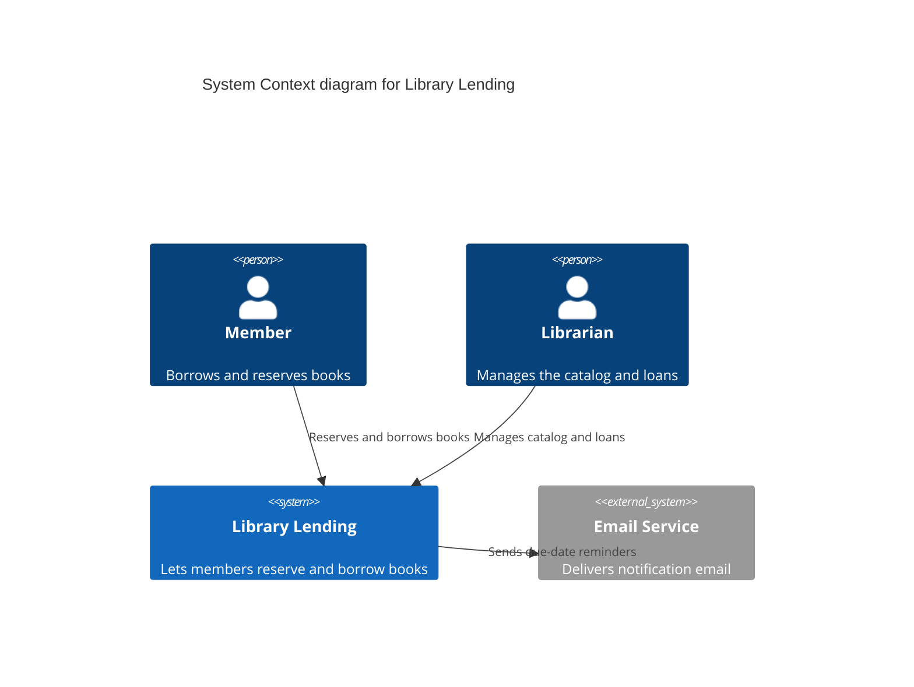
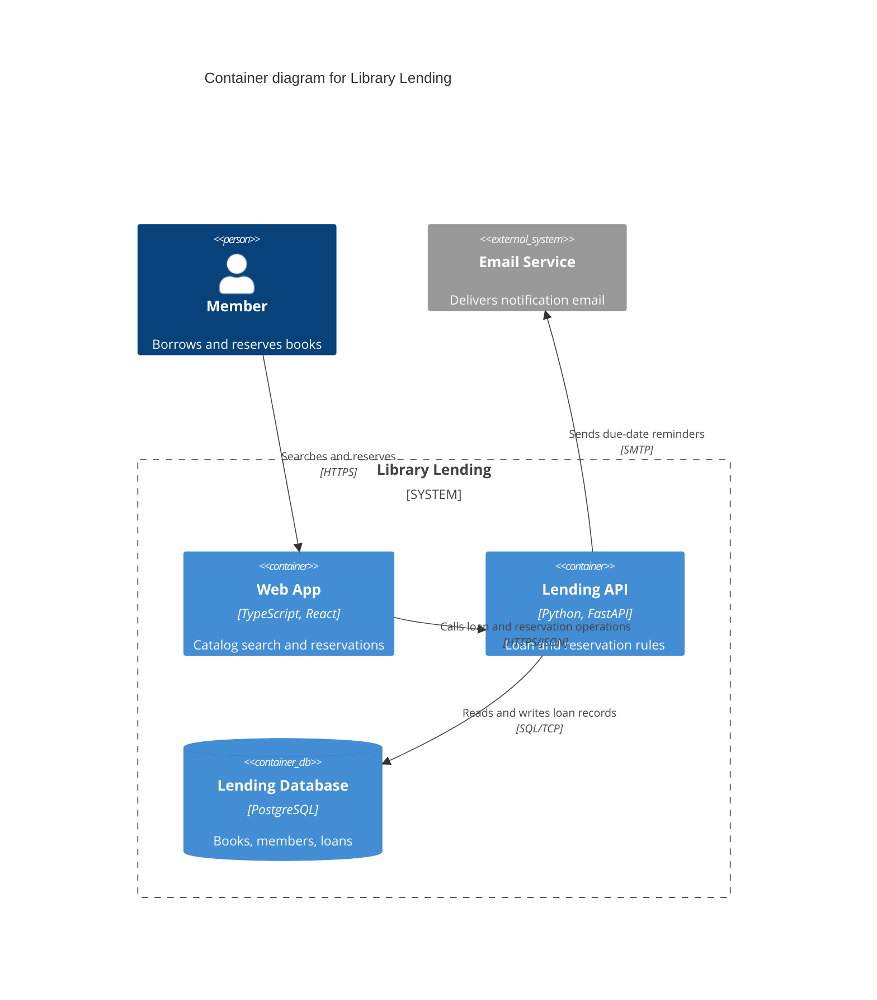
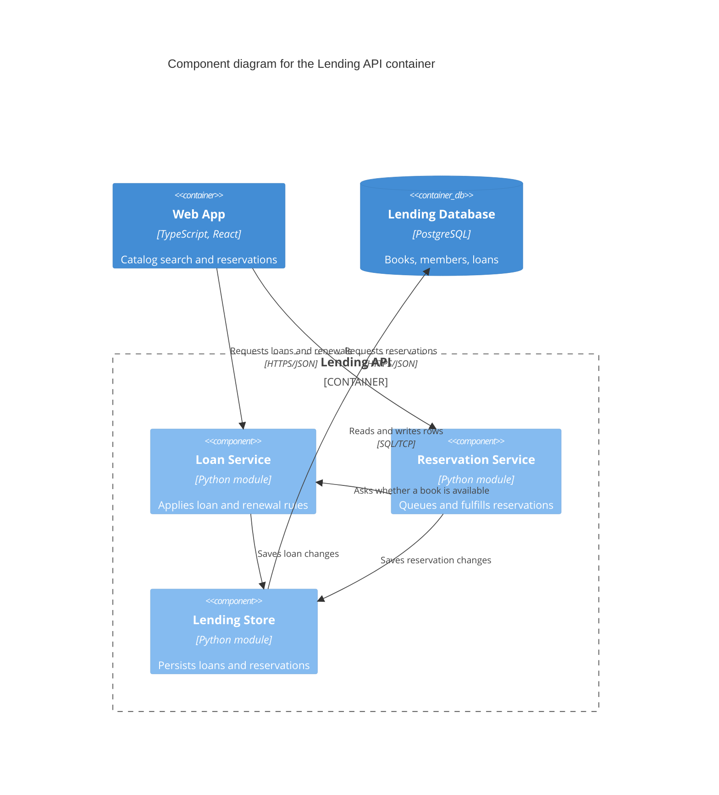
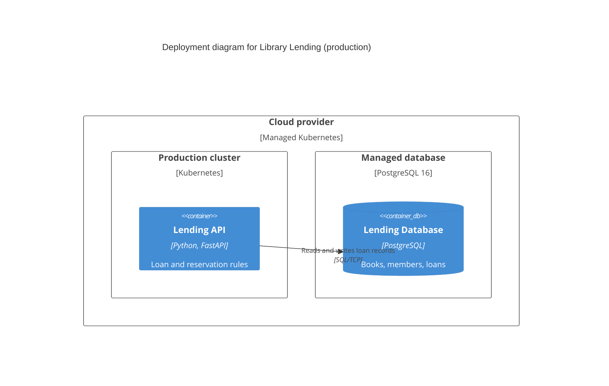

# Mermaid C4 notation

Every C4 diagram in `docs/architecture/` is a Mermaid diagram. This file fixes
the notation rules and gives one small example per diagram type, all for the
same toy system: a library lending app. Syntax reference:
<https://mermaid.js.org/syntax/c4.html>.

## Rules

1.  **Title.** Every diagram starts with a `title` line that names the diagram
    type and the scope, for example `System Context diagram for Library
    Lending` or `Component diagram for the Lending API container`.
2.  **Elements.** Every element has a type (`Person`, `System`, `System_Ext`,
    `Container`, `ContainerDb`, `Component`), a name, and a one-line
    description. Containers and components also name their technology.
3.  **Relationships.** Every `Rel` has a label that states intent ("Reserves
    books", not "Uses"). Between containers, the technology argument names the
    protocol and format (`HTTPS/JSON`, `SQL/TCP`). Never write a bare "Uses".
4.  **One level per diagram.** A context diagram shows people and systems only.
    A container diagram shows containers inside one system boundary. A
    component diagram shows components inside one container boundary.
5.  **Legend.** Mermaid C4 has no legend feature, so every diagram is followed
    by a `**Legend**` line, then a two-column `Shape | Meaning` table with one
    row per element type and line style used.
6.  **Layout.** Add `UpdateLayoutConfig($c4ShapeInRow="3",
    $c4BoundaryInRow="1")` as the last line when the default layout is
    cramped. Do not use it to hide an overloaded diagram; split the diagram
    instead.
7.  **Names.** Use the exact names from the upper level document and from
    `GLOSSARY.md`.

## C4Context

**Legend**

| Shape | Meaning |
| :---- | :------ |
| Person | A human user of the system |
| System | The system in scope |
| System_Ext | An external system we do not build |
| Arrow | Relationship; the label states intent |

## C4Container

**Legend**

| Shape | Meaning |
| :---- | :------ |
| Container | A deployable unit; the technology argument names its technology |
| ContainerDb | A data store |
| Boundary | The system in scope |
| Arrow | Relationship; label is intent, the technology argument is the protocol |

## C4Component

**Legend**

| Shape | Meaning |
| :---- | :------ |
| Component | A module with an interface; the technology argument names its technology |
| Boundary | The container in scope |
| Arrow | Relationship; label is intent; protocol only when it crosses a container |

## C4Deployment

**Legend**

| Shape | Meaning |
| :---- | :------ |
| Deployment_Node | Infrastructure that hosts containers; the technology argument names its technology |
| Container, ContainerDb | The same containers as the container diagram |
| Arrow | Relationship; label is intent, the technology argument is the protocol |

## Vocabulary map

The C4 levels connect to the codebase-design vocabulary used by the C4 code
step:

*   A C3 component corresponds to a **deep module**: a small interface that
    hides substantial behavior.
*   A **seam** in a C3 document is the **test seam**: the place where the C4
    step tests that component's behavior without reaching into its internals.
