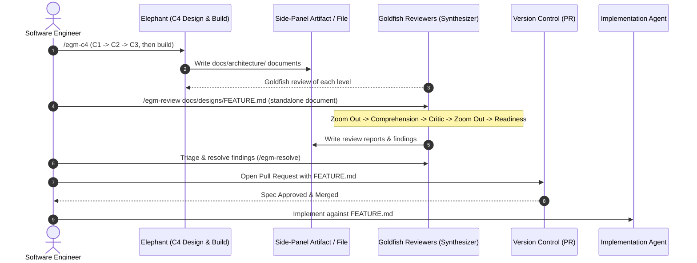

# EGM Architecture & System Lifecycle

*   **Authors:** Jim Quinn ([@quinnjim](https://github.com/quinnjim)), Elise Ewing ([@eewing314](https://github.com/eewing314)), Dave Rensin ([@drensin](https://github.com/drensin))
*   **Status:** Current
*   **Date:** 2026-06-06

--------------------------------------------------------------------------------

## Overview

The **Elephant-Goldfish Model (EGM)** is an implementation of Spec-Driven
Development (SDD) based on [Elephants, Goldfish, and the New Golden Age of Software Engineering](https://medium.com/@drensin/elephants-goldfish-and-the-new-golden-age-of-software-engineering-c33641a48874).
It emphasizes collaborative use of AI for design and review, maintaining verified
technical specifications checked directly into the codebase.

This document specifies the overarching system architecture of EGM: its
component model, its end-to-end dataflow, and its lifecycle across coding agent
runtimes.

## The Problem

Unstructured, conversational AI code generation suffers from four systemic
failure modes:

1.  **Hallucination Cascades & Context Pollution**: When a single LLM thread
    interviews the developer, creates the design, and writes the code, the
    session context accumulates speculative hypotheses and conversational bias.
    The model validates its own faulty assumptions instead of detecting errors.
2.  **Premature Implementation ("Weeds Syndrome")**: Coding agents default to
    writing code immediately in nearby files, bypassing high-level architectural
    placement, simplicity checks (YAGNI), and existing infrastructure reuse.
3.  **Chat Dump Fatigue**: Presenting multi-page design specs or lengthy review
    feedback directly in chat windows clutters conversation history, degrades
    LLM context performance, and creates poor user ergonomics.
4.  **Documentation Drift**: Design documents written during project kickoff
    routinely rot as code evolves, breaking future AI agent onboarding.

## Design Principles

*   **The Elephant & The Goldfish**:

    *   **The Elephant**: A deep-context agent loaded with system history, CUJs,
        and codebase maps to explore requirements and draft designs.
    *   **The Goldfish**: Isolated, zero-context subagent reviewers evaluating
        drafts against rubrics without access to context bias.

*   **Human Ownership**: AI is a tool for exploration and review; the human
    engineer is responsible for architectural decisions, trade-offs, and owns
    the outcome.

*   **Artifact-First UX**: All long-form deliverables (drafts, summaries, review
    reports) are rendered into dedicated side-panel markdown artifacts or
    workspace files with interactive feedback checkpoints.

*   **Living Specifications**: Designs are checked-in artifacts in the source
    tree (`docs/designs/`), continuously monitored against codebase drift.

## System Architecture & Component Model

The open-source EGM framework is organized into four decoupled subsystems:

### 1. Skills Layer (`skills/`)
Modular agent capabilities executable via slash commands or direct invocation:
*   `egm-c4`: Greenfield orchestrator that takes a project through C1, C2 and C3
    design documents with Goldfish review, then builds it in test-first slices.
*   `egm-review`: Orchestrator for the multi-stage review pipeline.
*   `egm-review-loop`: Concurrent subagent review dispatcher.
*   `egm-resolve`: Interactive resolution and patch application.
*   `egm-drift-report`: Agent workflow comparing specs and READMEs to code via host search and file-reading tools.
*   `egm-bootstrap`: Recursive bottom-up codebase documentation generator.

### 2. Personas Layer (`agents/`)
Stateless system prompt instructions for isolated Goldfish reviewer subagents
(Comprehension, Design Critic, Implementation Readiness, Codebase Auditor,
Structural Validator, Style Editor, Inventive Catalyst, and Synthesizer).

### 3. Document Standards (`resources/document_standards/`)
Goldfish reviewers load the versioned rubrics listed in the
[shared runtime resources](../../resources/README.md). Those files own the
evaluation requirements; this design describes how the layers use them.

### 4. Living Documentation (`docs/`)
User guides (`getting_started.md`, `faq.md`) and technical design specifications
(`docs/designs/`).

## End-to-End Lifecycle & Dataflow

The EGM development pipeline transitions artifacts through four disciplined
phases:

### Phase 1: C4 Design and Build (The Elephant)

*   **Command**: `/egm-c4`
*   **Mechanics**: The Elephant grills the engineer, then drafts C1 System
    Context, C2 Container and C3 Component documents under
    `docs/architecture/`. Each level is reviewed by Goldfish reviewers in fresh
    subagents and approved by the human before the next level starts. After
    approval, the Elephant builds the project in test-first slices.
*   **Output**: The C1, C2 and C3 documents, the build plan, and the slice files.
    See [c4.md](c4.md) for the full design.

### Phase 2: Isolated Verification (The Goldfish)

*   **Command**: `/egm-review` (for standalone documents outside the C4 flow)
*   **Execution**: Executes a five-stage evaluation pipeline:
    1.  **Step 5: Zoom Out Review**: Evaluates simplicity, YAGNI, and codebase
        reuse against `zoom-out-standard.md`.
    2.  **Step 6: Comprehension Test**: Isolated naive reader audits the doc for
        self-containment and missing background knowledge.
    3.  **Step 7: Critic Review**: Evaluates system design, scale bottlenecks,
        and failure modes against `feature-spec-standard.md`.
    4.  **Step 8: Intermediate Zoom Out**: Re-audits additions made during the
        Comprehension and Critic stages against `zoom-out-standard.md`.
    5.  **Step 9: Implementation Readiness Test**: Verifies file paths, function
        signatures, and test cases against
        `implementation-readiness-standard.md`.
*   **Subagent Fan-Out/Fan-In**: The `synthesizer` persona spawns isolated
    reviewers in parallel, aggregates raw findings, deduplicates overlaps, and
    writes consolidated markdown reports.

### Phase 3: Human Review & Submission

*   The human engineer resolves or rejects Goldfish findings using
    `/egm-resolve`, updates the design doc, and submits the
    specification via Pull Request for human peer review.

### Phase 4: Implementation & Drift Monitoring

*   **Execution**: Coding agents implement code strictly adhering to the
    approved design document. (No Skill.md is required here because the design 
    document is complete and detailed.)
*   **Phase Write Boundaries**: Phases 2-3 (`/egm-review` and
    `/egm-resolve`) should write only specification and review artifacts: the
    review reports, the design doc, and `SITEMAP.md` if it exists. They should not
    change production source code or dependencies. This is a convention, and
    nothing enforces it. Once Step 9 (Implementation Readiness Test) passes,
    the plan's `Target Scope & File Boundary` list is the set of files Phase 4
    implementation may write.
*   **Maintenance**: `/egm-drift-report` is run periodically (e.g. weekly) to
    detect divergence between codebase implementations and checked-in design docs.

## Artifact-First UX Protocol

To maintain conversation health and prevent context degradation, all EGM skills
adhere to the following UX protocol:

1.  **Chat Dump Prohibition**: Tools and skills must never dump large proposals,
    drafts, or review logs into the main chat stream.
2.  **Artifact Emission**: All content must be written directly to dedicated
    side-panel artifacts (with `RequestFeedback: true` in Antigravity) or to
    persistent workspace files.
3.  **Turn-Yielding Checkpoints**: When user feedback or triage is required, the
    calling skill notifies the user with a concise message pointing to the
    artifact and yields execution.
4.  **Queue Clearance**: Once the user completes a checkpoint review, the
    calling skill clears pending feedback markers.

## References

*   Dave Rensin, [Elephants, Goldfish, and the New Golden Age of Software Engineering](https://medium.com/@drensin/elephants-goldfish-and-the-new-golden-age-of-software-engineering-c33641a48874) (Medium, 2026).

## Alternatives Considered

*   **Monolithic In-Thread Review vs. Multi-Subagent Pipeline**:
    *   *Alternative*: Run review prompts sequentially within the same chat
        session.
    *   *Rejection*: Severe context degradation and confirmation bias; the model
        validates its own mistakes.
*   **Direct-to-Code vs. Spec-Driven Development**:
    *   *Alternative*: Prompting agents to generate code directly from feature
        requests.
    *   *Rejection*: Results in higher comment density per kLOC, duplicated
        utility implementations, and zero checked-in architectural memory.
