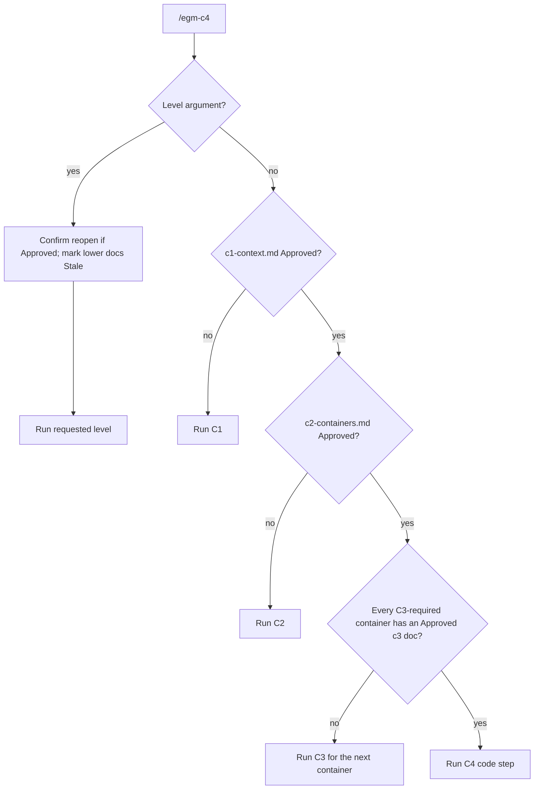

# EGM C4: Greenfield Development with the C4 Model

*   **Author:** [@Sapico-BE](https://github.com/Sapico-BE)
*   **Status:** Draft
*   **Date:** 2026-11-10

--------------------------------------------------------------------------------

## Overview

This design replaces the `egm-brainstorm` → `egm-draft` entry flow with one
orchestrator skill, `egm-c4`, that takes a greenfield software project through
the [C4 model](https://c4model.com/). The Elephant interviews the user and
drafts one architecture document per level, C1 System Context, C2 Container
and C3 Component. Goldfish reviewers audit each document before the user
approves it. The fourth step, "C4", does not draw a code diagram. It turns the
approved documents into a build plan, a project skeleton, and test-first
vertical slices.

The existing review machinery stays: `egm-review-loop`, `egm-resolve`, the
synthesizer, and the reviewer personas. The skill reuses interview, domain
language, module design, ticketing, and test-driven development mechanics from
[mattpocock/skills](https://github.com/mattpocock/skills) (MIT license), adapted
to C4 vocabulary and credited in `THIRD_PARTY_NOTICES.md`.

## The Problem

EGM drafts one design document per feature for an existing codebase. A
greenfield project has no codebase, so the current flow has gaps:

*   **One flat document.** `egm-draft` writes a single feature spec. A new system
    needs its context, its deployable units, and the inside of each unit
    decided in that order, by different audiences.
*   **Reviewers assume existing code.** `egm-codebase-details` and the zoom-out
    standard's "Leverage Existing" check look for code that a greenfield project
    does not have yet.
*   **No path to code.** The workflow ends at an approved design. Phase 5 is an
    unspecified coding agent, so the design and the generated project can drift
    apart from the first commit.
*   **Diagrams have no standard.** The draft template asks for "ASCII or Mermaid"
    diagrams but sets no notation rules, so reviewers cannot check them.

The C4 model gives a level-by-level structure with a notation reviewers can
audit. This design wires that structure into the Elephant/Goldfish loop and
extends the loop through code generation.

## Goals

*   One command, `/egm-c4`, routes the user to the next unfinished C4 level by
    reading the `**Status:**` field of the architecture documents.
*   Each of C1, C2 and C3 produces a checked-in Markdown document under
    `docs/architecture/` in the target project, with a Mermaid C4 diagram that
    follows the notation rules in `skills/egm-c4/references/mermaid-c4.md`.
*   Each level runs: grilling interview → section-by-section drafting with
    approval gates → Goldfish review through `egm-review-loop` against
    `c4-model-standard` → user approval → hand-off.
*   A shared `GLOSSARY.md` and `docs/adr/` keep names and hard-to-reverse
    decisions consistent across levels.
*   The C4 step writes code only after the user approves a reviewed build plan,
    and only inside that plan's Target Scope & File Boundary.
*   The C4 step produces a project skeleton whose build and tests run, then
    implements vertical-slice tickets test-first with implementer and
    code-review subagents.
*   When a lower level contradicts an approved upper level, the skill stops,
    offers to reopen the upper document, and marks lower documents `Stale`.
*   `egm-brainstorm` and `egm-draft` are removed; every registration point,
    test, and document that names them is updated in the same change.

## Non-Goals

*   Reverse-engineering C4 models from an existing codebase. `egm-bootstrap`
    and `egm-drift-report` cover existing code.
*   Structurizr DSL, PlantUML, or any rendering toolchain. Mermaid is the only
    notation.
*   C4 level 4 code diagrams. c4model.com marks them optional and best
    generated by tooling.
*   Deploying, provisioning infrastructure, handling secrets, creating
    repositories, or opening pull requests. The C4 step may write deployment
    configuration files but never applies them.
*   Depending on an installed copy of mattpocock/skills. The relevant mechanics
    are vendored and adapted.
*   Copying any file from [bitsmuggler/c4-skill](https://github.com/bitsmuggler/c4-skill).
    The repository has no license; only its ideas inform this design.
*   Supporting more than one software system per run. A system landscape
    diagram is out of scope.

## Open Questions

*   **Upstream divergence.** Removing `egm-brainstorm` and `egm-draft` makes this
    fork diverge from google/elephant-goldfish-model. Merging upstream changes to
    those skills will need manual porting into `egm-c4` references.
*   **Interview cadence.** `resources/execution_instructions.md` requires one
    question per response. Grilling asks a numbered round of questions, each with
    a recommended answer. This design scopes an exception to `egm-c4` interview
    rounds; the maintainer must confirm it.

## Critical User Journeys (CUJs)

### CUJ 1: Start a greenfield project

*   **Given**: An empty or near-empty repository with no `docs/architecture/`.
*   **When**: The user runs `/egm-c4` and describes the idea.
*   **Then**: The skill routes to C1, runs grilling rounds until no question is
    open, drafts `docs/architecture/c1-context.md` section by section, runs the
    C1 Goldfish review, and on approval sets `**Status:** Approved` and offers
    to continue with C2.

### CUJ 2: Resume at the next level

*   **Given**: `c1-context.md` and `c2-containers.md` are Approved. C2 lists the
    containers `web`, `api` and `db`, with `db` marked `C3: skip (managed
    database)`.
*   **When**: The user runs `/egm-c4` in a new session.
*   **Then**: The skill reports the current state and starts C3 for `web`. After
    `c3-web.md` is approved it routes to `api`, then to the C4 step.

### CUJ 3: Force a level

*   **Given**: Any state of `docs/architecture/`.
*   **When**: The user runs `/egm-c4 c3 api` or `/egm-c4 c1`.
*   **Then**: The skill opens that level for that target, after confirming that
    an Approved document will return to Draft and lower documents become
    `Stale`.

### CUJ 4: A lower level contradicts an upper level

*   **Given**: C2 is Approved. While grilling C3 for `api`, the user and Elephant
    discover the system needs a message queue container.
*   **When**: The Elephant detects that the C3 draft depends on an element absent
    from C2.
*   **Then**: The skill stops drafting, names the contradiction, and offers to
    reopen C2. On approval, C2 returns to Draft, every C3 document is set to
    `Stale`, and C2 is edited and reviewed again before C3 resumes.

### CUJ 5: Generate the project

*   **Given**: C1, C2 and every required C3 document are Approved.
*   **When**: The user runs `/egm-c4`.
*   **Then**: The skill drafts `docs/architecture/c4-build-plan.md` and slice
    tickets, runs the build-plan review, and waits for approval. It then writes
    the skeleton and slice 01, runs the build and tests, and shows the output.
    After approval it implements the remaining slices in batches, each batch
    followed by code review and a user gate. It ends with `egm-drift-report`
    and sets the documents' Status to `Implemented`.

### CUJ 6: Refuse early code

*   **Given**: C2 is in Draft.
*   **When**: The user asks the skill to "just generate the API code".
*   **Then**: The skill declines, explains that code is written only in the C4
    step after the build plan is approved, and asks whether to continue the
    current level.

## Technical Plan (Architecture)

### Components

| Component | Responsibility |
| :-------- | :------------- |
| `skills/egm-c4/SKILL.md` | Entry point. Reads harness guidance, detects state, routes to a level, enforces gates, write boundaries and the reopen rule. |
| `references/grilling.md` | Interview method adapted from mattpocock `grilling`: build a decision tree, ask the open frontier as a numbered round with a recommended answer for each, look facts up instead of asking, stop when the frontier is empty. |
| `references/domain-language.md` | Glossary and ADR rules adapted from mattpocock `domain-modeling`: every diagram name is defined in `GLOSSARY.md`; ADRs only for decisions that are hard to reverse, surprising, and a real trade-off. |
| `references/mermaid-c4.md` | Notation rules and one example per diagram type. Maps codebase-design vocabulary to C4: component ≈ deep module, seam = test seam. |
| `references/c1-context.md` | C1 playbook: seed questions, document template, diagram type, ready-for-review criteria. |
| `references/c2-container.md` | C2 playbook, including the per-container `C3: required` or `C3: skip (<reason>)` field. |
| `references/c3-component.md` | C3 playbook for one container. |
| `references/c4-code.md` | Build plan template, slice ticket template, skeleton stage, slice loop, finish. Adapts mattpocock `to-tickets`, `tdd` and `code-review`. |
| `resources/document_standards/c4-model-standard.md` | Goldfish rubric for C4 documents. |

### Routing

`/egm-c4` reads `docs/architecture/` in the target project:

Status values are `Draft`, `In Review`, `Approved`, `Stale` and `Implemented`.
A missing file counts as `Draft`. A `Stale` document routes like `Draft`, but the
skill first shows what changed above it. The documents are the only state; there
is no separate state file.

### Level loop (C1, C2, C3)

1.  **Grill.** Load `grilling.md` and the level playbook. Seed the decision tree
    from the playbook's seed questions and the approved upper documents. Ask
    rounds until the frontier is empty.
2.  **Draft.** Write the level document section by section. After each section,
    show it and ask for approval before the next one. Keep `GLOSSARY.md` and
    `docs/adr/` current.
3.  **Readiness check.** The Elephant checks the playbook's ready-for-review
    criteria and fixes gaps before review.
4.  **Goldfish review.** Run `egm-review-loop` with `TargetFile` set to the level
    document, `Standards` set to `c4-model-standard`, and the reviewers below.
5.  **Approve.** On the user's explicit approval, set `**Status:** Approved` and
    offer the next level.

| Level | Reviewers |
| :---- | :-------- |
| C1 | `egm-zoom-out`, `egm-comprehension`, `egm-design`, `egm-structural`, `egm-style` |
| C2 | `egm-design`, `egm-zoom-out`, `egm-structural`, `egm-style` |
| C3 | `egm-design`, `egm-zoom-out`, `egm-structural`, `egm-style`, `egm-implementation-readiness` |
| Build plan | `egm-implementation-readiness`, `egm-style`; standards `c4-model-standard` and `implementation-readiness-standard` |

`egm-codebase-details` is not used for C1 to C3 because no code exists yet.

### Level documents

| | C1 `c1-context.md` | C2 `c2-containers.md` | C3 `c3-<container>.md` |
| :-- | :-- | :-- | :-- |
| Audience | Everyone | Technical staff | Developers |
| Seed questions | Problem and purpose; people and personas; external systems; CUJs; goals and non-goals; scale, compliance, budget | Deployable units and data stores; technology per container; protocols; hosting; authentication and authorization; observability | Components and responsibilities; deep-module interfaces; dependencies; data ownership; error handling; test seams |
| Sections | Overview, Problem, Goals, Non-Goals, People, External Systems, CUJs (Given/When/Then), System Context diagram (`C4Context`), Quality Attributes and Constraints, Open Questions | Overview, Container table (name, type, technology, responsibility, data owned, C3 field), Container diagram (`C4Container`), Relationships table (from, to, intent, protocol), CUJ walkthrough, optional Deployment diagram (`C4Deployment`), Cross-cutting Concerns, Key Decisions (ADR links), Alternatives Considered, Open Questions | Overview, Component table (name, responsibility, interface summary, depends on), Component diagram (`C4Component`), Interfaces (prose and pseudo-signatures), Test Seams, CUJ trace, Error Handling, Open Questions |
| Ready for review when | Every person and external system has a description; every CUJ uses only diagram elements; no open question blocks C2 | Every C1 element is accounted for; every container has technology and responsibility; every relationship has intent and protocol; every CUJ is traceable | Every C2 relationship touching this container is realized by a component; every component has an agreed test seam |

### C4 code step

1.  **Build plan** (documents only). Draft `docs/architecture/c4-build-plan.md`:
    target file tree (C2 container → top-level project, C3 component → module
    with its interface), toolchain per container, slice tickets in
    `docs/architecture/slices/NN-<slice>.md`, and a Target Scope & File
    Boundary. Slice 01 is always the walking skeleton: one CUJ end to end
    through real containers. Each ticket lists the components it touches, its
    test seams, acceptance criteria from a CUJ, and the tickets it waits on.
    Review, then wait for approval.
2.  **Skeleton.** Scaffold the tree, build, test and CI configuration, a root
    `README.md`, and an `AGENTS.md` that points at `docs/architecture/` and
    `GLOSSARY.md`. Implement slice 01. Run the build and tests and show the
    output. Wait for approval.
3.  **Slices.** For each unblocked ticket, dispatch an implementer subagent that
    works red-green at the ticket's test seams. Independent tickets may run in
    parallel worktrees. A code-review subagent checks each diff against code
    standards and against the C3 interfaces and the ticket. After each batch,
    show results and wait for approval.
4.  **Finish.** Run `egm-drift-report` on `docs/architecture/` and set each
    implemented document to `Implemented`.

Writes in steps 2 and 3 are limited to the approved Target Scope & File
Boundary. A design contradiction found while building follows CUJ 4.

### Interaction with execution rules

`resources/execution_instructions.md` gains two scoped exceptions for
`egm-c4`:

*   **Code writing.** Allowed only in the C4 step, after build-plan approval,
    inside the Target Scope & File Boundary. All other levels remain
    design-only.
*   **Interview rounds.** A grilling round may present several numbered
    questions with recommended answers. Every other gate still asks one
    question.

## Alternatives Considered

### Alternative A: Four level skills

*   **Pros**: One skill per phase, matching EGM's style. Code-writing permission
    sits in its own skill. Each skill stays small.
*   **Cons**: Four commands to learn and register across every harness. Routing
    between levels is the user's job.
*   **Reason for Rejection**: Rejected by author: one entry point that detects the
    current level is simpler to use.

### Alternative B: Two skills, design and build

*   **Pros**: Clean split between documents and code.
*   **Cons**: Re-entering a single C3 container inside one long design skill is
    clumsy.
*   **Reason for Rejection**: Rejected by author: the orchestrator handles
    re-entry with a level argument.

### Alternative C: Structurizr DSL as the model

*   **Pros**: One model for all views, the approach c4model.com recommends for
    long-lived documentation, and the one bitsmuggler/c4-skill uses.
*   **Cons**: Needs Docker or a CLI to validate and render. Exported images are
    hard to review in pull requests.
*   **Reason for Rejection**: Rejected by author: Mermaid renders on GitHub with
    no tooling, and reviewers check cross-level consistency instead.

### Alternative D: Keep `egm-brainstorm` and `egm-draft`

*   **Pros**: Easier upstream merges; non-greenfield feature work keeps its flow.
*   **Cons**: Two overlapping entry points.
*   **Reason for Rejection**: Rejected by author: this fork is C4-first, and the
    useful parts of both skills move into `egm-c4` references.

--------------------------------------------------------------------------------

## Non-Functional Requirements

*   **Skill size.** `skills/egm-c4/SKILL.md` body stays under the 24,000-byte
    limit enforced by `tests/unit/test_skill_load_limits.py`. Level detail lives
    in references loaded on demand.
*   **Token cost.** Each level loads only its own playbook plus `grilling.md`,
    `domain-language.md` and `mermaid-c4.md`.
*   **Licensing.** Adapted mattpocock/skills text carries an MIT attribution in
    each adapted reference and in `THIRD_PARTY_NOTICES.md`. No bitsmuggler/c4-skill
    text is copied.
*   **Safety.** No code is written before build-plan approval. Deployment files
    are written but never applied. No secrets are requested or stored.
*   **Rollback.** Revert the implementation commit; the removed skills return
    from history.

--------------------------------------------------------------------------------

### Additional Resources

*   [c4model.com](https://c4model.com/): levels, notation, supplementary diagrams.
*   [mattpocock/skills](https://github.com/mattpocock/skills): `grilling`,
    `domain-modeling`, `codebase-design`, `to-tickets`, `tdd`, `code-review`.
*   [bitsmuggler/c4-skill](https://github.com/bitsmuggler/c4-skill): prior art for
    C4 generation from existing code (ideas only).
*   [Mermaid C4 diagrams](https://mermaid.js.org/syntax/c4.html).
*   [architecture.md](architecture.md) and [review.md](review.md).

### Future Improvements

*   **System landscape.** Support several software systems with a landscape
    diagram.
*   **Dynamic diagrams.** Generate a Mermaid sequence diagram for complex CUJs.
*   **Structurizr export.** Optionally emit `workspace.dsl` from the Mermaid model.

--------------------------------------------------------------------------------

## Detailed Implementation Plan

### Target Files to Create/Modify

#### 1. `skills/egm-c4/SKILL.md` (Create)

*   **Type / Scope**: Skill entry point.
*   **Proposed Changes**: Frontmatter `name: egm-c4`, a description,
    `license: Apache-2.0`, `disable-model-invocation: true`. Harness doc pointers
    to `../../docs/codex.md` and `${CLAUDE_PLUGIN_ROOT}/docs/claude.md`. Sections:
    inputs (optional level argument and container), routing, level loop, reopen
    rule, write boundary, C4 step summary, hand-offs. Body under 24,000 bytes.

#### 2. `skills/egm-c4/references/*.md` (Create)

*   **Type / Scope**: Skill references.
*   **Proposed Changes**: `grilling.md`, `domain-language.md`, `mermaid-c4.md`,
    `c1-context.md`, `c2-container.md`, `c3-component.md`, `c4-code.md` with
    the content described in the Technical Plan. Level templates move here from
    `skills/egm-draft/references/design_doc.md`.

#### 3. `skills/egm-c4/TEST.md`, `test_scenarios.yaml`, `agents/openai.yaml`, `assets/icon.svg` (Create)

*   **Type / Scope**: Skill metadata and scenarios.
*   **Proposed Changes**: Scenarios for CUJs 1 to 6. Icon uses the create-skill
    palette `#1b6ef3`/`#7cacf8`.

#### 4. `resources/document_standards/c4-model-standard.md` and `resources/README.md` (Create, Modify)

*   **Type / Scope**: Goldfish rubric.
*   **Proposed Changes**: Checks that each diagram has a title and legend; each
    element has type and description, plus technology for containers and
    components; each relationship has an intent label, plus protocol between
    containers, never a bare "Uses"; no level mixing; names match the upper
    level and `GLOSSARY.md`; the level's ready-for-review criteria hold.

#### 5. `resources/execution_instructions.md` (Modify)

*   **Type / Scope**: Shared rules.
*   **Proposed Changes**: Add the two scoped `egm-c4` exceptions.

#### 6. `skills/egm-brainstorm/`, `skills/egm-draft/` (Delete)

*   **Type / Scope**: Removed skills.
*   **Proposed Changes**: Delete both folders after moving reusable content into
    `egm-c4` references.

#### 7. `agents/synthesizer.md` and its adapters (Modify)

*   **Type / Scope**: Synthesizer persona.
*   **Proposed Changes**: Remove BRAINSTORM mode, which only `egm-brainstorm`
    used.

#### 8. `THIRD_PARTY_NOTICES.md` (Create)

*   **Type / Scope**: Licensing.
*   **Proposed Changes**: MIT notice for adapted mattpocock/skills material,
    listing each adapted reference.

#### 9. Registration points (Modify)

*   **Type / Scope**: Packaging and tests.
*   **Proposed Changes**: Replace `egm-brainstorm` and `egm-draft` with `egm-c4`
    in `scripts/pack_plugin.py` (`SKILLS`, `REQUIRED_SHARED`),
    `tests/unit/test_harnesses.py` (`EXPECTED_SKILLS`),
    `tests/unit/test_packaging.py` (icon parametrize),
    `com.github.copilot/agents/egm.agent.md`, `.cursor-plugin/rules/egm.mdc`, and
    `plugin.json` / `.codex-plugin/plugin.json` listing text where skills are
    named. Regenerate `distributions/claude/` with
    `python scripts/pack_plugin.py --target claude`.

#### 10. Documentation and site (Modify)

*   **Type / Scope**: User documentation.
*   **Proposed Changes**: Update `README.md`, `docs/getting_started.md`,
    `docs/designs/architecture.md`, and the harness guides (`docs/claude.md`,
    `docs/codex.md`, `docs/cursor.md`, `docs/copilot.md`, `docs/opencode.md`,
    `docs/muse.md`, `docs/faq.md`) where they name the removed skills, and `site/src/components/Skills.astro`, `SkillIcon.astro` and
    `Loop.astro`. Mark `docs/designs/brainstorm.md` and `docs/designs/draft.md`
    `Superseded by c4.md`. Update `docs/designs/README.md`.

### Verification Plan

*   **Unit Tests**: `pytest tests/unit` passes, including frontmatter, scenario
    coverage, skill size, harness skill sets, packaging reproducibility, link
    integrity and table checks.
*   **Static checks**: `grep -rn "egm-brainstorm\|egm-draft"` returns only
    historical design documents and release notes.
*   **Packaging**: `distributions/claude/` equals fresh `pack_plugin.py` output.
*   **Manual dry run**: Run `/egm-c4` on a small sample project in a scratch
    directory through C1, C2, one C3 and an approved build plan; confirm routing,
    the reopen rule (CUJ 4) and the early-code refusal (CUJ 6).
*   **Live integration (optional)**: `EGM_CLAUDE_LIVE=1 pytest tests/integration/test_claude.py`.

--------------------------------------------------------------------------------

*Drafted with EGM*
