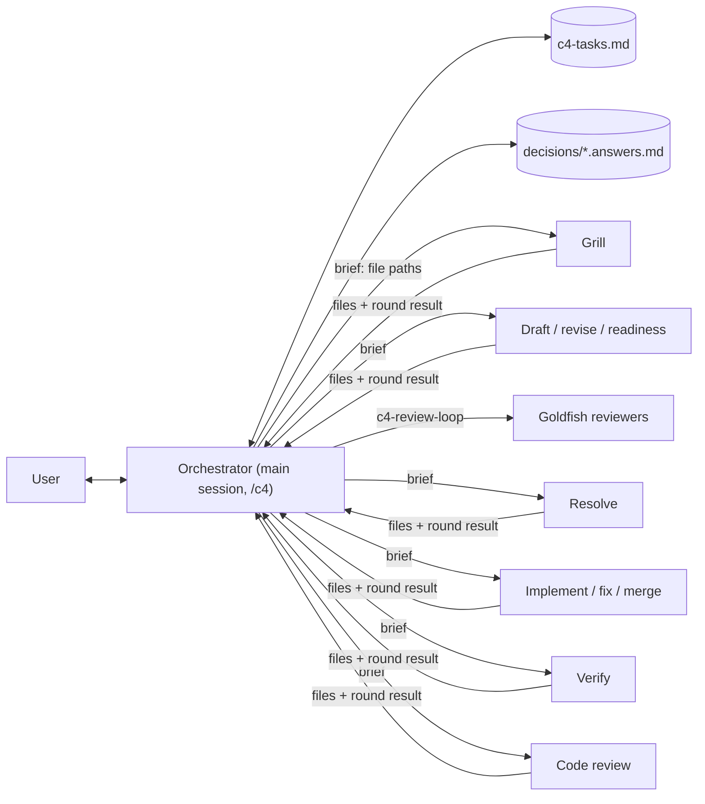

# EGM C4: Greenfield Development with the C4 Model

*   **Author:** [@Sapico-BE](https://github.com/Sapico-BE)
*   **Status:** Draft
*   **Date:** 2026-11-10

--------------------------------------------------------------------------------

## Overview

This design replaces the `egm-brainstorm` → `egm-draft` entry flow with one
orchestrator skill, `c4`, that takes a greenfield software project through
the [C4 model](https://c4model.com/): C1 System Context, C2 Container and C3
Component documents, then a fourth step, "C4", that generates the project
skeleton and implements it in test-first vertical slices.

Two principles shape the skill:

*   **The main session only orchestrates.** It keeps a task ledger of done and
    open work, which grows as results reveal new tasks. It dispatches rounds,
    shows their results to the user, and records the user's answers. It does
    not draft documents, judge review findings, run builds, or write code.
*   **Every round starts from fresh context.** Each grilling round, draft,
    revision, review resolution, build verification, slice and code review runs
    in a new subagent that receives file paths, not conversation history. Files
    are the only memory between rounds.

Grilling has priority. Every level starts with grilling rounds and no level is
drafted until the grilling frontier is empty. The draft is written only from
the recorded decisions.

The existing review machinery stays: `c4-review-loop`, `c4-resolve`, the
synthesizer, and the reviewer personas. The skill adapts interview, domain
language, module design, ticketing and test-driven development mechanics from
[mattpocock/skills](https://github.com/mattpocock/skills) (MIT license),
credited in `THIRD_PARTY_NOTICES.md`.

## The Problem

EGM drafts one design document per feature for an existing codebase. A
greenfield project has no codebase, so the current flow has gaps:

*   **One flat document.** `egm-draft` writes a single feature spec. A new system
    needs its context, its deployable units, and the inside of each unit
    decided in that order, by different audiences.
*   **Context accumulates.** The Elephant interviews, drafts and revises in one
    long thread. Earlier turns bias later work, and a long session loses detail
    when its context is summarized.
*   **Decisions are implicit.** Answers live in chat, so a draft can contain
    choices the user never made, and a later session cannot see why a choice
    was made.
*   **Reviewers assume existing code.** `c4-codebase-details` and the zoom-out
    standard's "Leverage Existing" check look for code a greenfield project
    does not have.
*   **No path to code.** The workflow ends at an approved design, so the design
    and the generated project can drift apart from the first commit.
*   **Diagrams have no standard.** The draft template asks for "ASCII or Mermaid"
    diagrams but sets no notation rules, so reviewers cannot check them.

## Goals

*   One command, `/c4`, resumes the project from its task ledger,
    `docs/architecture/c4-tasks.md`, and runs the next ready task.
*   The main session acts only as orchestrator and writes only the files in the
    orchestrator row of the Roles table. Every other file is written by a round
    subagent or by the existing review skills.
*   Every round runs in a fresh subagent whose brief lists input file paths and
    an output contract. No round receives conversation history.
*   Every level, the build plan, and every reopened level starts with grilling.
    Drafting starts only when a grilling round reports an empty frontier and the
    user confirms it.
*   Every user answer is recorded verbatim in an append-only answers file under
    `docs/architecture/decisions/`, and every statement in a level document
    traces to a recorded answer or an approved upper document.
*   Each of C1, C2 and C3 produces a checked-in Markdown document under
    `docs/architecture/` with a Mermaid C4 diagram that follows
    `skills/c4/references/mermaid-c4.md`.
*   Each level document passes Goldfish review through `c4-review-loop` before
    the user approves it.
*   The C4 step writes code only after the user approves a reviewed build plan,
    and only inside each ticket's allowed paths, checked after every round.
*   When a round finds that a lower level contradicts an approved upper level,
    the orchestrator offers to reopen the upper document and marks dependent
    tasks `stale`.
*   `egm-brainstorm` and `egm-draft` are removed; every registration point,
    test, and document that names them is updated in the same change.

## Non-Goals

*   Reverse-engineering C4 models from an existing codebase. `c4-bootstrap`
    and `c4-drift-report` cover existing code.
*   Structurizr DSL, PlantUML, or any rendering toolchain. Mermaid is the only
    notation.
*   C4 level 4 code diagrams. c4model.com marks them optional and best
    generated by tooling.
*   Deploying, provisioning infrastructure, handling secrets, creating
    repositories, or opening pull requests. The C4 step may write deployment
    configuration files but never applies them.
*   Host-enforced sandboxing of subagent writes. Write limits are instructions
    plus an after-the-fact path check.
*   Depending on an installed copy of mattpocock/skills. The relevant mechanics
    are vendored and adapted.
*   Copying any file from [bitsmuggler/c4-skill](https://github.com/bitsmuggler/c4-skill).
    The repository has no license; only its ideas inform this design.
*   Supporting more than one software system per run. A system landscape
    diagram is out of scope.
*   Staying mergeable with google/elephant-goldfish-model. This fork diverges
    deliberately.

## Open Questions

None at this time.

## Critical User Journeys (CUJs)

### CUJ 1: Start a greenfield project

*   **Given**: A repository with no `docs/architecture/`.
*   **When**: The user runs `/c4` and describes the idea.
*   **Then**: The orchestrator creates `c4-tasks.md` with the C1 tasks and
    records the idea as the first entry in `decisions/c1.answers.md`. It
    dispatches a grill subagent, shows its numbered questions with recommended
    answers, and records the user's answers. Each following round is a new grill
    subagent, until one reports an empty frontier and the user confirms. A draft
    subagent writes `c1-context.md`, review runs, and on approval the
    orchestrator sets the document to Approved and adds the C2 tasks.

### CUJ 2: Resume in a new session

*   **Given**: The ledger shows C1 and C2 approved, and C2 added C3 tasks for
    `web` and `api`. `db` is marked `C3: skip (managed database)` in C2.
*   **When**: The user runs `/c4` in a new session.
*   **Then**: The orchestrator reads the ledger, shows done and open tasks, and
    starts the first ready task: grilling C3 for `web`.

### CUJ 3: Force a level

*   **Given**: C1 and C2 are Approved; C3 for `api` is Approved.
*   **When**: The user runs `/c4 c3 api`.
*   **Then**: The orchestrator confirms that `c3-api.md` will return to Draft and
    the tasks that depend on it become `stale`, then starts a grill round for
    `api` that keeps the existing decision log. Forcing a level whose upper
    levels are not Approved is refused with the reason.

### CUJ 4: A lower level contradicts an upper level

*   **Given**: C2 is Approved. A C3 grill round for `api` finds the system needs
    a message queue container that C2 lacks.
*   **When**: The grill subagent returns the contradiction in its result.
*   **Then**: The orchestrator stops the C3 work, names the contradiction, and
    offers to reopen C2. On approval, it records the contradiction in
    `decisions/c2.answers.md`, sets C2 to Draft, adds C2 grill, draft, readiness,
    review and approve tasks, and marks every task that depends on C2 `stale`,
    including C4 tasks. C2 is grilled, redrafted and reviewed. On its approval the
    orchestrator reconciles the C3 tasks with the new container table before C3
    resumes.

### CUJ 5: Generate the project

*   **Given**: C1, C2 and every required C3 document are Approved.
*   **When**: The user runs `/c4`.
*   **Then**: Grilling rounds settle toolchain, slice order and granularity. A
    draft subagent writes `c4-build-plan.md` and slice tickets, review runs, and
    the user approves. The orchestrator adds tasks per slice and a `drift`
    task. An implementer subagent builds slice 01, the walking skeleton, which
    includes the project scaffolding, and a verify subagent runs the build and
    tests and returns a summary. After the user approves that batch, ready
    slices run in batches. Each slice is implemented, merged, verified and code-reviewed by
    fresh subagents, and each batch ends at a user gate. The step ends with
    `c4-drift-report`.

### CUJ 6: Refuse early code

*   **Given**: C2 is in Draft.
*   **When**: The user asks to "just generate the API code".
*   **Then**: The orchestrator declines, explains that code is written only in
    the C4 step after build-plan approval, and asks whether to continue the
    current task.

## Technical Plan (Architecture)

### Roles

| Role | Context | Writes |
| :--- | :------ | :----- |
| Orchestrator | Main session | `docs/architecture/c4-tasks.md`; `decisions/*.answers.md` (append-only); `**Status:**` lines; replacement text the user approved at a resolve gate, applied verbatim; the user's gate decisions recorded verbatim in the round report, marked `Status: resolved`; under direct dispatch, each reviewer's returned findings, saved verbatim to the scope's review folder |
| Grill round | Fresh subagent | `decisions/<scope>.tree.md` |
| Draft, revise and readiness rounds | Fresh subagent | One level document or the build plan and its tickets, `GLOSSARY.md`, `docs/adr/` (readiness writes nothing) |
| Goldfish reviewers and synthesizer | Fresh subagents, as in `c4-review-loop` | Review reports in the scope's review folder |
| Resolve round | Fresh subagent | `goldfish_review_report.<RunId>.round-<n>.md` with dispositions and proposed replacement text |
| Implement, fix and merge rounds | Fresh subagent | Files inside the ticket's allowed paths |
| Verify round | Fresh subagent | Build outputs only; returns a summary |
| Code-review round | Fresh subagent, read-only | Nothing; returns findings |

The orchestrator may run read-only commands for path checks. Before and after
every round it snapshots `git status --porcelain --untracked-files=all` and
the `git hash-object` of every listed path; a path that is new, changed status
or changed hash was changed by the round. A changed path outside the round's
declared outputs is shown to the user, who keeps or reverts it. In the C4 step
it also reads `git rev-parse` and `git diff --name-only` for the slice branch
and the integration branch. It never runs builds or tests.

### Skill files

| File | Responsibility |
| :--- | :------------- |
| `skills/c4/SKILL.md` | Orchestrator: read the ledger, pick the next ready task, dispatch rounds, present results, record answers, update the ledger, run gates and path checks. |
| `references/ledger.md` | Ledger format, task types and statuses, Status mapping, dependency, stale and reconcile rules. |
| `references/rounds.md` | One brief template per round type: inputs, instructions, output files, and when the round returns `needs_user`. |
| `references/round-result.schema.json` | JSON schema every round returns. |
| `references/grilling.md` | Grilling method adapted from mattpocock `grilling`, plus the tree and answers file formats. |
| `references/domain-language.md` | Glossary and ADR rules adapted from mattpocock `domain-modeling`. |
| `references/mermaid-c4.md` | Notation rules and one example per diagram type; maps codebase-design vocabulary to C4. |
| `references/c1-context.md`, `c2-container.md`, `c3-component.md` | Level playbooks: seed questions, document template, diagram type, ready-for-review criteria. |
| `references/c4-code.md` | Build plan and slice ticket templates, skeleton, slice loop, build-time contradictions; adapts `to-tickets`, `tdd` and `code-review`. |
| `resources/document_standards/c4-model-standard.md` | Goldfish rubric for C4 documents. |

### Task ledger

`docs/architecture/c4-tasks.md` holds one table:

| Column | Content |
| :----- | :------ |
| `ID` | `T01`, `T02`, … in creation order |
| `Scope` | `C1`, `C2`, `C3:<container>`, `C4`, `C4:slice-NN` |
| `Task` | `grill`, `draft`, `revise`, `readiness`, `review`, `approve`, `implement`, `merge`, `verify`, `code-review`, `fix`, `drift` |
| `Status` | `todo`, `in-progress`, `done`, `blocked`, `stale` |
| `Depends on` | Task IDs |
| `Output` | File the task produced |
| `Notes` | Round count, contradictions, user overrides |

One `grill` task spans all rounds for its scope; `Notes` counts them. A
`review` task spans one `c4-review-loop` run.

**Next ready task.** The first `todo` or `stale` task, in ID order, whose
dependencies are all `done`. An `in-progress` task left by an interrupted
session is resumed first: a round task reruns in a fresh subagent from its
files, a `review` loop reruns, and an `approve` is asked again; outputs the
interrupted round already wrote are path-checked again.

**Slice batches.** Batches restrict only `C4:slice-NN` tasks and the `drift`
task. When a batch starts, the orchestrator adds `batch Bn` to the Notes of
each member slice's `implement` task (`B1` is slice 01 alone); when the user
approves the batch gate, it adds `Bn approved`. At most one batch is open.
While it is open, only its member slices' tasks, including their `fix`
chains, are ready; the next batch takes every ready `implement` without a
batch label, and `drift` is ready only when no batch is open. Tasks of other
scopes, such as a reopened level, are ready whether or not a batch is open.

**Status mapping.** Document Status follows the scope's highest-ID `approve`
task:

| Document `**Status:**` | Ledger state |
| :--------------------- | :----------- |
| `Draft` (or file missing) | `approve` task is not `done` |
| `Approved` | `approve` task is `done`; the `Implemented` conditions do not all hold |
| `Implemented` | `approve` is `done`, every slice touching the scope is `done`, and the `drift` task is `done` |

On start, the orchestrator checks this mapping for each document and asks the
user to resolve any mismatch. When an `approve` task becomes `stale`, the
orchestrator sets that document's `**Status:**` line to `Draft`.

**Adding tasks.** The orchestrator adds tasks only by these rules:

*   C1 approved → C2 grill, draft, readiness, review, approve.
*   C2 approved → the same five tasks per container marked `C3: required`, then
    the C4 grill, draft, readiness, review and approve tasks for the build plan.
*   Build plan approved → per slice: implement, merge, verify, code-review;
    then one `C4` `drift` task that waits on every slice.
*   Section changes or review findings that need more than an approved
    replacement → `revise`, then a new `readiness`, `review` and `approve`. A
    change that needs a new decision → `grill` first.
*   Blocking code-review findings, failed verification, a path-check violation
    on the slice branch, or a change the user requests at a batch gate → `fix`,
    then `merge`, `verify` and `code-review` again.
*   User rejects at `approve` → `revise` (or `grill` if a new decision is
    needed), then `readiness`, `review` and a new `approve`.

**Superseding.** When a `revise` (or `grill`) chain is added for a scope, the
scope's pending `readiness`, `review` and `approve` tasks (including an
`approve` the user just rejected) are set `done` with Notes `superseded by Txx`.
When a `fix` chain is added for a slice, its pending `merge`, `verify` and
`code-review` tasks are superseded the same way, and tasks that waited on the
slice's last `verify` or `code-review` (later slices' `implement`, the `drift`
task) wait on the chain's new `code-review`. Because the Status mapping reads
the highest-ID `approve`, a superseded `approve` never sets a document to
Approved.

Tasks a round proposes in `new_tasks` are added only after the user confirms.

**Reopening.** When the user accepts a contradiction or forces an Approved level:

1.  Set the reopened document to Draft and add `grill`, `draft`, `readiness`,
    `review` and `approve` tasks for it. The `grill` round starts from the
    existing tree and answers, plus the contradiction.
2.  Mark every task that transitively depends on the old `approve` task
    `stale`, and point its dependency at the new `approve` task. Stale tasks
    therefore cannot run before the upper level is approved again. Tasks
    whose Notes say `superseded by` are skipped and stay `done`. Each
    `approve` that becomes `stale` sets its document's Status line to Draft.
3.  A stale `grill` reruns from its existing log and the upper level's changes;
    a stale `draft` becomes a `revise` of the existing document.

**Reconcile after C2 changes.** When C2 is approved again, the orchestrator
compares the container table with the C3 tasks. It adds tasks for new
`C3: required` containers, marks tasks for removed or `C3: skip` containers
`done` with a note, and keeps renamed containers' tasks after asking the user.

**Blocked tasks.** A task becomes `blocked` after an invalid round result is
retried once, or when a round returns `outcome: blocked`. It returns to `todo`
when the user says to retry it.

### Round contract

Each brief names the round type, the ledger task ID, the reference files to
load, the input files, and the output files. A round reads nothing else from
the conversation and writes only its output files. Each round returns a result
matching `round-result.schema.json`:

| Field | Content |
| :---- | :------ |
| `task_id` | Ledger task ID |
| `outcome` | `complete`, `needs_user`, or `blocked` |
| `files_written` | Paths |
| `questions` | Numbered questions, each with a recommended answer and the decision it settles |
| `frontier_empty` | `true` when no decision is open (grill rounds) |
| `contradictions` | Upper-level statements this round contradicts, with evidence |
| `new_tasks` | Proposed ledger tasks with dependencies |
| `summary` | At most five lines for the orchestrator to show |

A grill round returns `needs_user` with questions, or `complete` with
`frontier_empty: true`. Other rounds return `needs_user` only to report a
contradiction or a choice the brief cannot settle. The orchestrator validates
each result, retries an invalid one once with a fresh subagent, and then marks
the task `blocked`.

### Grilling rounds

Grilling is adapted from mattpocock `grilling`. Each scope (`c1`, `c2`,
`c3-<container>`, `c4-plan`) has two files in `docs/architecture/decisions/`:

*   `<scope>.tree.md`: the decision tree with each node `open`, `decided`
    (citing an answer entry) or `deferred`. Only grill rounds rewrite it.
*   `<scope>.answers.md`: append-only entries, each with a round number, the
    question, the recommendation, and the user's verbatim answer. Everything
    else the user says that a round must see (the idea in round 0, added
    topics, section changes, batch-gate changes, accepted contradictions) is a
    note entry `## Round <N>, note <M>`, cited `R<N>-N<M>`. Only the
    orchestrator writes it.

A round works as follows:

1.  The orchestrator dispatches a grill subagent with `grilling.md`, the level
    playbook, both decision files, approved upper documents, and `GLOSSARY.md`.
2.  The subagent rebuilds the tree from the answers, looks up facts it can find
    in files instead of asking, writes the tree, and returns the open frontier
    as numbered questions with recommended answers.
3.  The orchestrator shows the round. For each question the user answers,
    accepts the recommendation, or skips. The orchestrator appends the entries.
    A skipped question becomes `deferred`: it leaves the frontier and the draft
    lists it under Open Questions, unless the user brings it back.
4.  The next round is a new subagent. When a round returns
    `frontier_empty: true`, the orchestrator asks the user to confirm. If the
    user adds topics, they are appended as answers and another round runs.

### Level loop (C1, C2, C3)

1.  **Grill** until the frontier is empty and confirmed.
2.  **Draft.** A fresh subagent writes the level document only from the
    decision files and approved upper documents, with `**Status:** Draft`. A
    statement it cannot trace becomes an Open Question. It updates
    `GLOSSARY.md` and adds ADRs.
3.  **Section approval.** The orchestrator shows the draft section by section.
    Requested changes are appended to the answers file and run as a revise
    round; a change that needs a new decision runs a grill round first.
4.  **Readiness.** A fresh subagent checks the playbook's ready-for-review
    criteria and returns gaps; gaps add a revise task.
5.  **Goldfish review.** The orchestrator runs `c4-review-loop` with
    `ResolveMode: delegated`, `RunId` set to the ledger `review` task ID, the
    reviewer and standard mapping below, and `GoldfishContext` set to the
    scope's decision files, the approved upper documents, `GLOSSARY.md`, and
    the note "greenfield project: no existing code to leverage". For the build
    plan, `GoldfishContext` adds every slice ticket and the review target
    covers the tickets too. `ReportDir` is `docs/architecture/reviews/<scope>/`,
    which keeps the loop's settled-findings list across runs. Report names
    carry the run and round: `goldfish_review_report.<RunId>.round-<n>.md`,
    and under direct dispatch the orchestrator saves each reviewer's returned
    findings verbatim as `findings.<RunId>.round-<n>.<reviewer>.md`.
    Convergence counts only the current run's reports; the settled list reads
    every run's. Each round's resolution runs in a fresh resolve subagent that
    follows `c4-resolve` through its report and stops before the gate. The
    orchestrator shows the gate, applies replacement text the user approves
    verbatim, records the user's decisions verbatim in the round report and
    marks it `Status: resolved`, and adds a revise task for findings that need
    more.
6.  **Approve.** On explicit approval, the orchestrator sets
    `**Status:** Approved`, marks `approve` done, and adds the next tasks.

| Level | Reviewer → standard |
| :---- | :------------------ |
| C1 | `c4-zoom-out` → `zoom-out-standard`; `c4-comprehension` → none; `c4-design`, `c4-structural`, `c4-style` → `c4-model-standard` |
| C2 | `c4-zoom-out` → `zoom-out-standard`; `c4-design`, `c4-structural`, `c4-style` → `c4-model-standard` |
| C3 | as C2, plus `c4-implementation-readiness` → `c4-model-standard` |
| Build plan | `c4-implementation-readiness` → `implementation-readiness-standard`; `c4-style` → `c4-model-standard` |

`c4-codebase-details` is not used for C1 to C3 because no code exists yet.

### Level documents

| | C1 `c1-context.md` | C2 `c2-containers.md` | C3 `c3-<container>.md` |
| :-- | :-- | :-- | :-- |
| Audience | Everyone | Technical staff | Developers |
| Seed questions | Problem and purpose; people and personas; external systems; CUJs; goals and non-goals; scale, compliance, budget | Deployable units and data stores; technology per container; protocols; hosting; authentication and authorization; observability | Components and responsibilities; deep-module interfaces; dependencies; data ownership; error handling; test seams |
| Sections | Overview, Problem, Goals, Non-Goals, People, External Systems, CUJs (Given/When/Then), System Context diagram (`C4Context`), Quality Attributes and Constraints, Open Questions | Overview, Container table (name, type, technology, responsibility, data owned, `C3: required` or `C3: skip (<reason>)`), Container diagram (`C4Container`), Relationships table (from, to, intent, protocol), CUJ walkthrough, optional Deployment diagram (`C4Deployment`), Cross-cutting Concerns, Key Decisions (ADR links), Alternatives Considered, Open Questions | Overview, Component table (name, responsibility, interface summary, depends on), Component diagram (`C4Component`), Interfaces (prose and pseudo-signatures), Test Seams, CUJ trace, Error Handling, Open Questions |
| Ready for review when | Every person and external system has a description; every CUJ uses only diagram elements; no open question blocks C2 | Every C1 element is accounted for; every container has technology and responsibility; every relationship has intent and protocol; every CUJ is traceable | Every C2 relationship touching this container is realized by a component; every component has an agreed test seam |

A C3 component corresponds to a deep module in codebase-design terms, and a
seam is the test seam the C4 step tests at. `mermaid-c4.md` states this mapping.

### C4 code step

1.  **Grill** toolchain per container, build and test commands, slice order and
    slice granularity until the frontier is empty and confirmed.
2.  **Build plan** (documents only). A draft subagent writes
    `docs/architecture/c4-build-plan.md`: target file tree (C2 container →
    top-level project, C3 component → module with its interface), toolchain and
    build and test commands per container, slice tickets in
    `docs/architecture/slices/NN-<slice>.md`, and a Target Scope & File Boundary
    that is the union of all tickets' allowed paths. Slice 01 is the walking
    skeleton: one CUJ end to end through real containers, and its allowed paths
    include the scaffolding (build files, CI configuration, root `README.md`,
    `AGENTS.md`). Each ticket lists the components it touches, its test seams,
    acceptance criteria from a CUJ, its allowed paths, and the tickets it waits
    on. The plan also names the integration branch and a worktree root (or
    `none`). Readiness, review and approval follow the level loop and cover
    the tickets. Before the `approve` gate the orchestrator checks that the
    integration branch has a commit; if not, it asks the user to commit
    `docs/architecture/`, `GLOSSARY.md` and `docs/adr/` (it never commits).
    Approval also consents to slice rounds writing under the worktree root;
    with `none`, slices run one at a time on slice branches in the project
    checkout. On approval the orchestrator adds the slice tasks and one
    `drift` task.
3.  **Slices.** Slice 01, the walking skeleton, runs alone as batch `B1`;
    later ready slices run in batches. For each slice:
    1.  **Implement.** A fresh implementer subagent works red-green at the
        ticket's test seams on branch `c4/NN-<slice>`, in a worktree under the
        worktree root or in the project checkout. It reuses an existing slice
        branch or worktree.
    2.  **Path check.** After every implement, fix and merge round, the
        orchestrator compares the changed paths (the snapshot, the slice-branch
        diff and new commits on the integration branch) with the ticket's
        allowed paths, or the batch's for a merge. A violation on the slice
        branch adds a `fix` chain that reverts the out-of-bounds changes. A
        violation elsewhere (the project checkout outside the slice branch, or
        commits on the integration branch) marks the task `blocked` until the
        user keeps or reverts each path.
    3.  **Merge.** A fresh merge subagent runs `git merge --no-ff --no-commit`,
        checks the staged paths against the batch's allowed paths, commits only
        if all are inside, and resolves conflicts only within those paths.
    4.  **Verify.** A fresh verify subagent runs the build plan's build and test
        commands and returns pass or fail with a short failure summary.
    5.  **Code review.** A fresh, read-only code-review subagent checks the
        slice diff (`git diff <merge>^1 <merge>` for the chain's merge commit)
        against code standards and against the C3 interfaces and the ticket.
        Blocking findings or a failed verification add a `fix` chain.

    After each batch, the orchestrator shows the results and asks whether to
    start the next batch. A change the user requests there is recorded as a
    note entry and adds a `fix` chain, or reopens the build plan when a ticket
    must change.
4.  **Finish.** The `drift` round runs `c4-drift-report` on
    `docs/architecture/`. After the user settles each finding and the `drift`
    task is `done`, the orchestrator sets each fully implemented document to
    `Implemented`.

**Contradictions while building.** In-progress slices stop. The reopen rule
applies to the contradicted level. Done slices that touch affected components
become `stale` with the note "rework against revised C3"; their code stays. The
build plan returns to Draft and is grilled again before any slice resumes.

### Interaction with execution rules

`resources/execution_instructions.md` gains scoped exceptions for `c4`:

*   **Code writing.** Allowed only for implement, fix and merge rounds in the C4
    step, after build-plan approval, inside the ticket's allowed paths.
*   **Round writes.** A round subagent may write its declared output files
    without a per-file go-ahead. Drafts keep `**Status:** Draft` until the user
    approves.
*   **Contradictions in rounds.** A round that finds a contradiction finishes
    its declared outputs and reports it. The orchestrator then makes no further
    changes until the user resolves it.
*   **Interview rounds.** A grilling round may present several numbered
    questions with recommended answers. Every other gate still asks one
    question.
*   **Orchestrator writes.** The main session writes only the files in the
    orchestrator row of the Roles table.

### Changes to existing review skills

*   `c4-review-loop` gains an optional `ResolveMode` input: `inline` (default,
    today's behavior) or `delegated`. In delegated mode, each round's resolution
    is dispatched to a fresh subagent that follows `c4-resolve` up to its
    report, and the caller runs the gate, records the user's decisions
    verbatim in the round report and marks it `Status: resolved`. A delegated
    caller has configured the run, so the loop does not re-ask the reviewer
    configuration and exits without the manual-invocation question.
*   `c4-review-loop` gains optional `ReportDir` (the folder for every report
    of the run) and `RunId` (required with `delegated`; `c4` passes the
    ledger `review` task ID). Round reports are
    `goldfish_review_report.<RunId>.round-<n>.md` and direct-dispatch findings
    `findings.<RunId>.round-<n>.<reviewer>.md`, so runs sharing a folder never
    overwrite each other. Convergence counts the current run's reports; the
    settled list reads every run's.
*   `c4-resolve` gains optional `ReportDir` and `StopBeforeGate` inputs. With
    `StopBeforeGate`, it writes the report under the name the caller gives,
    with dispositions and exact proposed replacement text, and returns without
    editing the target. Optional inputs never trigger its onboarding.

## Alternatives Considered

### Alternative A: Elephant drafts in the main session

*   **Pros**: Matches today's `egm-draft`. Fewer subagent dispatches.
*   **Cons**: Context accumulates across interview, drafting and revision.
    Decisions stay implicit in chat.
*   **Reason for Rejection**: Rejected by author: every round starts from fresh
    context, with files as the only memory.

### Alternative B: Four level skills

*   **Pros**: One skill per phase. Code-writing permission sits in its own skill.
*   **Cons**: Four commands to learn and register. Routing between levels is the
    user's job.
*   **Reason for Rejection**: Rejected by author: one orchestrator with a ledger
    routes automatically.

### Alternative C: Document Status as the only state

*   **Pros**: No extra file.
*   **Cons**: Cannot record rounds, slices, blocked work or tasks added by
    contradictions.
*   **Reason for Rejection**: Rejected by author: the ledger is the orchestrator's
    task list; Status fields remain for readers.

### Alternative D: Structurizr DSL as the model

*   **Pros**: One model for all views; the approach c4model.com recommends for
    long-lived documentation.
*   **Cons**: Needs Docker or a CLI to validate and render. Exported images are
    hard to review in pull requests.
*   **Reason for Rejection**: Rejected by author: Mermaid renders on GitHub with
    no tooling; reviewers check cross-level consistency.

### Alternative E: Keep `egm-brainstorm` and `egm-draft`

*   **Pros**: Easier upstream merges.
*   **Cons**: Two overlapping entry points.
*   **Reason for Rejection**: Rejected by author: this fork is C4-first.

--------------------------------------------------------------------------------

## Non-Functional Requirements

*   **Skill size.** `skills/c4/SKILL.md` stays under the 24,000-byte limit
    enforced by `tests/unit/test_skill_load_limits.py`. Round detail lives in
    references that only the relevant subagent loads.
*   **Token cost.** Fresh rounds re-read their inputs each time. Briefs list only
    the files a round needs; decision files hold the tree and answers, not
    transcripts; verify rounds return summaries, not full logs.
*   **Harness support.** Rounds need subagents. In Claude Cowork, subagents
    cannot spawn subagents, so the orchestrator dispatches every round and every
    reviewer directly, as `docs/claude.md` already requires.
*   **Licensing.** Adapted mattpocock/skills text carries an MIT attribution in
    each adapted reference and in `THIRD_PARTY_NOTICES.md`. No
    bitsmuggler/c4-skill text is copied.
*   **Safety.** No code is written before build-plan approval. Every code round
    is path-checked. Deployment files are written but never applied. No secrets
    are requested or stored.
*   **Rollback.** Revert the implementation commit; the removed skills return
    from history.

--------------------------------------------------------------------------------

### Additional Resources

*   [c4model.com](https://c4model.com/): levels, notation, supplementary diagrams.
*   [mattpocock/skills](https://github.com/mattpocock/skills): `grilling`,
    `domain-modeling`, `codebase-design`, `to-tickets`, `tdd`, `code-review`.
*   [bitsmuggler/c4-skill](https://github.com/bitsmuggler/c4-skill): prior art for
    C4 generation from existing code (ideas only).
*   [Mermaid C4 diagrams](https://mermaid.js.org/syntax/c4.html).
*   [architecture.md](architecture.md) and [review.md](review.md).

### Future Improvements

*   **System landscape.** Support several software systems with a landscape
    diagram.
*   **Dynamic diagrams.** Generate a Mermaid sequence diagram for complex CUJs.
*   **Structurizr export.** Optionally emit `workspace.dsl` from the Mermaid model.

--------------------------------------------------------------------------------

## Detailed Implementation Plan

Grilling is implemented and verified first, because every level depends on it:

1.  Orchestrator, ledger, round contract and grilling, verified end to end on C1
    grilling.
2.  C1 drafting, the review-skill changes and review, then C2 and C3.
3.  The C4 code step.
4.  Removal of the old skills, registration points, documentation and site.

### Target Files to Create/Modify

#### 1. `skills/c4/SKILL.md` (Create)

*   **Type / Scope**: Orchestrator skill.
*   **Proposed Changes**: Frontmatter `name: c4`, a description,
    `license: Apache-2.0`, `disable-model-invocation: true`. Harness doc pointers
    to `../../docs/codex.md` and `${CLAUDE_PLUGIN_ROOT}/docs/claude.md`. Sections:
    inputs (optional level and container), orchestrator role and write limits,
    start-up (read or create the ledger, check the Status mapping), next-task
    selection, round dispatch and result handling, grilling loop, level loop,
    reopen and reconcile rules, C4 step, hand-offs. Body under 24,000 bytes.

#### 2. `skills/c4/references/` (Create)

*   **Type / Scope**: Skill references.
*   **Proposed Changes**: `ledger.md`, `rounds.md`, `round-result.schema.json`,
    `grilling.md`, `domain-language.md`, `mermaid-c4.md`, `c1-context.md`,
    `c2-container.md`, `c3-component.md`, `c4-code.md`, with the content in the
    Technical Plan. Level templates move here from
    `skills/egm-draft/references/design_doc.md`.

#### 3. `skills/c4/TEST.md`, `test_scenarios.yaml`, `agents/openai.yaml`, `assets/icon.svg` (Create)

*   **Type / Scope**: Skill metadata and scenarios.
*   **Proposed Changes**: Scenarios for CUJs 1 to 6, an invalid round result, a
    skipped grilling question, a rejected approval, and a path-check violation.
    Icon uses the create-skill palette `#1b6ef3`/`#7cacf8`.

#### 4. `skills/c4-review-loop/SKILL.md` and `skills/c4-resolve/SKILL.md` (Modify)

*   **Type / Scope**: Shared review skills.
*   **Proposed Changes**: Add `ResolveMode` and `StopBeforeGate` as described in
    "Changes to existing review skills". Defaults keep today's behavior.

#### 5. `resources/document_standards/c4-model-standard.md` and `resources/README.md` (Create, Modify)

*   **Type / Scope**: Goldfish rubric.
*   **Proposed Changes**: Checks that each diagram has a title and legend; each
    element has type and description, plus technology for containers and
    components; each relationship has an intent label, plus protocol between
    containers, never a bare "Uses"; no level mixing; names match the upper
    level and `GLOSSARY.md`; every statement traces to the decision files or an
    upper document; the level's ready-for-review criteria hold.

#### 6. `resources/execution_instructions.md` (Modify)

*   **Type / Scope**: Shared rules.
*   **Proposed Changes**: Add the scoped `c4` exceptions.

#### 7. `skills/egm-brainstorm/`, `skills/egm-draft/` (Delete)

*   **Type / Scope**: Removed skills.
*   **Proposed Changes**: Delete both folders after moving reusable content into
    `c4` references.

#### 8. `agents/synthesizer.md` and its adapters (Modify)

*   **Type / Scope**: Synthesizer persona.
*   **Proposed Changes**: Remove BRAINSTORM mode, which only `egm-brainstorm`
    used.

#### 9. `THIRD_PARTY_NOTICES.md` (Create)

*   **Type / Scope**: Licensing.
*   **Proposed Changes**: MIT notice for adapted mattpocock/skills material,
    listing each adapted reference.

#### 10. Registration points (Modify)

*   **Type / Scope**: Packaging and tests.
*   **Proposed Changes**: Replace `egm-brainstorm` and `egm-draft` with `c4`
    in `scripts/pack_plugin.py` (`SKILLS`, `REQUIRED_SHARED`),
    `tests/unit/test_harnesses.py` (`EXPECTED_SKILLS`),
    `tests/unit/test_packaging.py` (icon parametrize),
    `com.github.copilot/agents/c4.agent.md`, `.cursor-plugin/rules/c4.mdc`, and
    `plugin.json` / `.codex-plugin/plugin.json` listing text where skills are
    named. Regenerate `distributions/claude/` with
    `python scripts/pack_plugin.py --target claude`.

#### 11. Documentation and site (Modify)

*   **Type / Scope**: User documentation.
*   **Proposed Changes**: Update `README.md`, `docs/getting_started.md`,
    `docs/designs/architecture.md`, `docs/designs/review.md` for the new review
    inputs, and the harness guides (`docs/claude.md`, `docs/codex.md`,
    `docs/cursor.md`, `docs/copilot.md`, `docs/opencode.md`, `docs/muse.md`,
    `docs/faq.md`) where they name the removed skills, and
    `site/src/components/Skills.astro`, `SkillIcon.astro` and `Loop.astro`. Mark
    `docs/designs/brainstorm.md` and `docs/designs/draft.md`
    `Superseded by c4.md`. Update `docs/designs/README.md`.

### Verification Plan

*   **Unit Tests**: `pytest tests/unit` passes, including frontmatter, scenario
    coverage, skill size, harness skill sets, packaging reproducibility, link
    integrity and table checks. A new test validates
    `round-result.schema.json` against example results in
    `references/rounds.md`.
*   **Static checks**: `grep -rn "egm-brainstorm\|egm-draft"` returns only
    historical design documents and release notes.
*   **Packaging**: `distributions/claude/` equals fresh `pack_plugin.py` output.
*   **Manual dry run, grilling first**: On a small sample project in a scratch
    directory, run C1 grilling for at least three rounds and confirm each round
    is a new subagent, answers land verbatim in `decisions/c1.answers.md`, the
    tree updates, and the ledger updates. Then continue through C2, one C3 and
    an approved build plan; confirm the reopen and reconcile rules (CUJ 4) and
    the early-code refusal (CUJ 6).
*   **Regression**: `c4-review` on an existing design document still behaves
    as before with default `ResolveMode` and `StopBeforeGate`.
*   **Live integration (optional)**: `EGM_CLAUDE_LIVE=1 pytest tests/integration/test_claude.py`.

--------------------------------------------------------------------------------

*Drafted with EGM*
